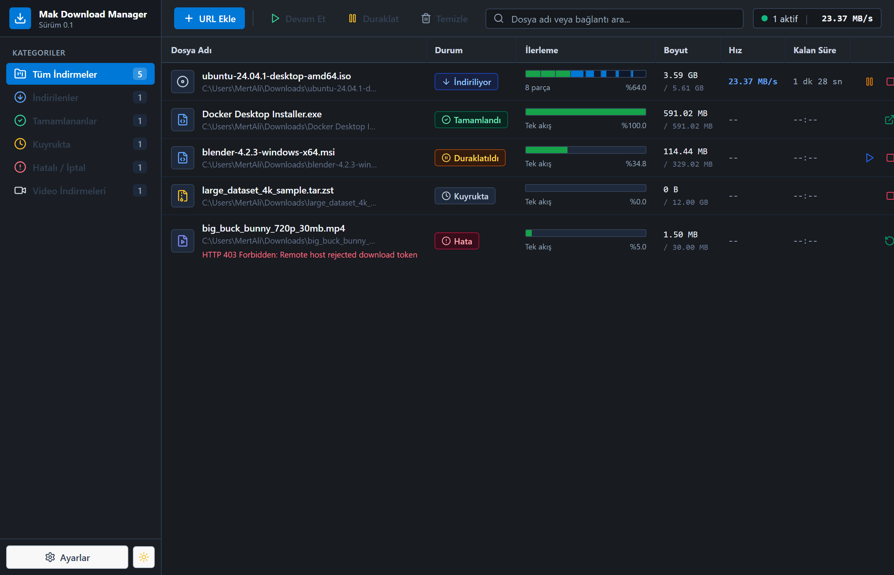
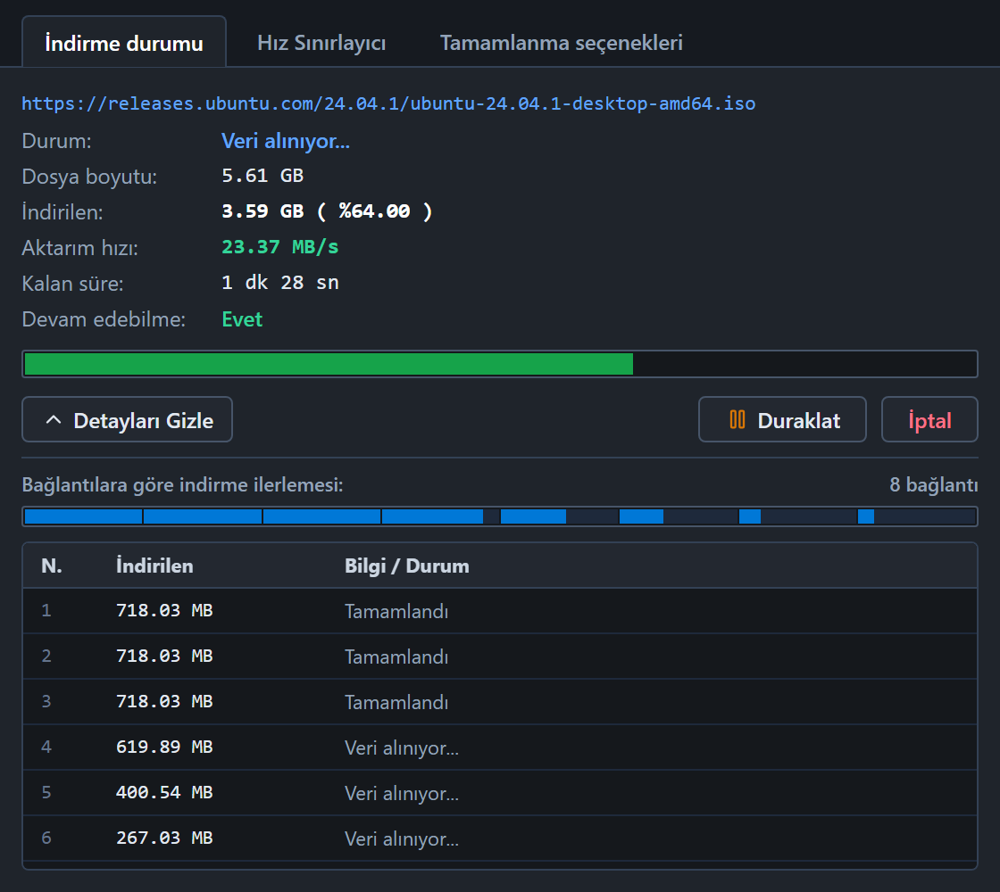
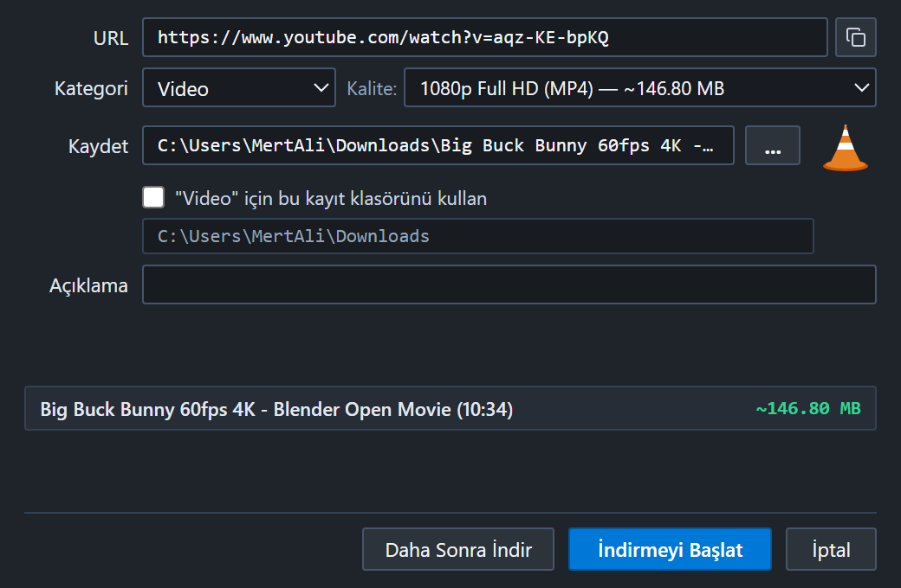
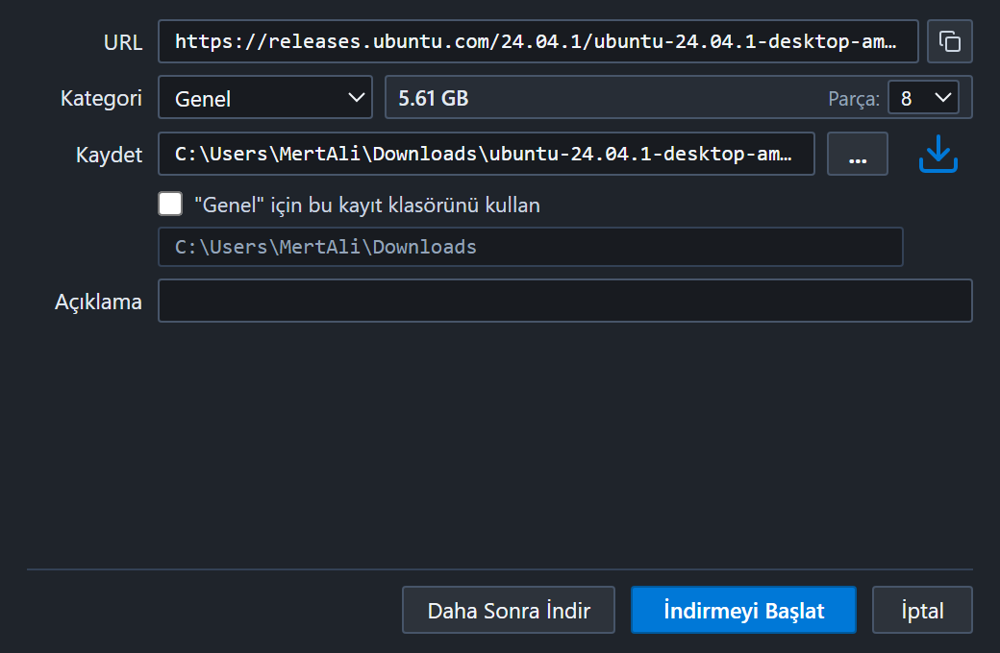
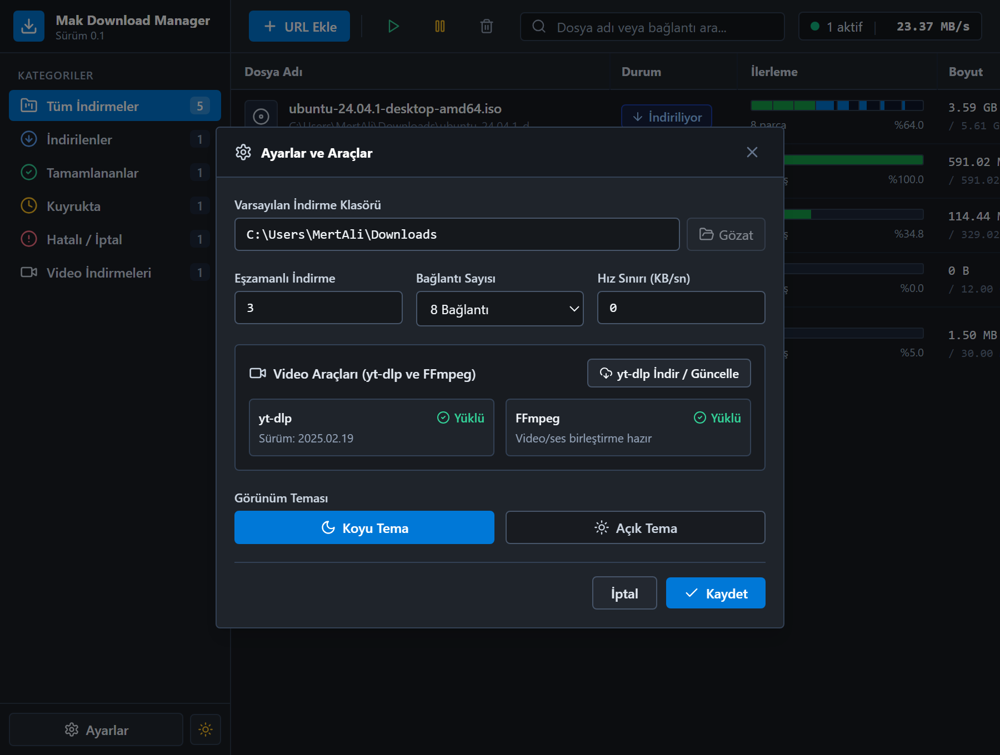
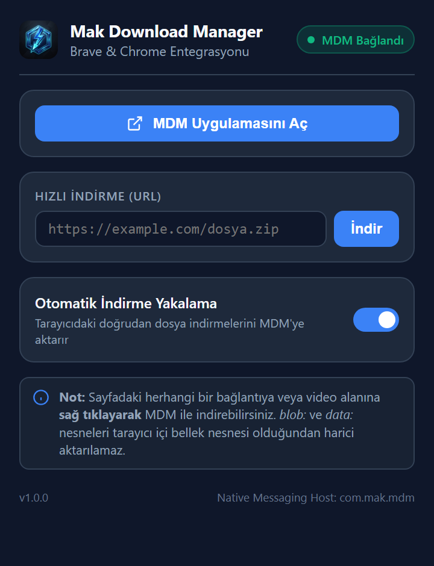

# Mak Download Manager (MDM)

**Mak Download Manager (MDM)**, Windows masaüstü için **Tauri 2 + Rust + React** mimarisiyle geliştirilmiş, çok parçalı HTTP indirme ve akıllı tarayıcı video yakalama özelliklerine sahip modern bir indirme yöneticisidir.

---

## Öne Çıkan Özellikler

- **Çok Parçalı Paralel İndirme Motoru (`1 / 2 / 4 / 8 / 16` Bağlantı):** Sunucunun `HTTP 206 Partial Content` desteğini otomatik test eder; varsayılan **8 bağlantı** ile dosyayı parçalara ayırarak doğrudan diske yazar, ardından atomik birleştirme (`.mdmmerge`) ve `0% -> 100%` canlı birleştirme ilerlemesi sunar.
- **Sıfır Bellek Tamponlama & Çakışma Koruması:** Gelen veri akışları bellekte tutulmadan doğrudan `.part<n>` dosyalarına yazılır; aynı isimde dosya varsa üzerine yazmak yerine otomatik olarak `_1`, `_2` ekleriyle güvenli dosya adı üretir.
- **Akıllı Video & Akış Yakalama (`HLS .m3u8` / `DASH .mpd` / MP4):** Chrome/Brave tarayıcı eklentisi, normal videoları ve gömülü oynatıcılardaki gizli akışları sayfa başlıklarıyla (`Referer`, `Origin`, `User-Agent`, çerezler) birlikte yakalar ve arka planda `yt-dlp` + `ffmpeg` desteğiyle indirip birleştirir.
- **Sorunsuz Tarayıcı Entegrasyonu (Native Messaging):** İndirmeleri yakaladığında tarayıcının varsayılan kaydetme penceresini bastırır, medya oynatıcılar üzerinde **"MDM ile İndir"** butonu ve sağ tık menüsü sunar.
- **Canlı İlerleme, Hız Sınırlayıcı & Tamamlama Kontrolü:** Parça bazlı görselleştirme, indirme sırasında anlık hız limiti tanımlama, duraklatıp kaldığı yerden devam etme, indirme bitiminde **Dosyayı Aç** / **Klasörü Aç** ile hızlı erişim.
- **Dahili Otomatik Güncelleyici:** Açılışta ve **Ayarlar** ekranından GitHub Releases üzerinden yeni sürüm kontrolü yapar, paket için **SHA-256** doğrulaması uygular, indirilen güncellemeyi sessiz NSIS kurulumu (`/S`) ile kurup uygulamayı otomatik yeniden başlatır.

---

## Ekran Görüntüleri

| Ana Yönetim Ekranı | İndirme İlerleme & Segment Görünümü |
| :---: | :---: |
|  |  |

| Video Akışı Yakalama | Dosya İndirme Onayı |
| :---: | :---: |
|  |  |

| Ayarlar & Otomatik Güncelleme | Tarayıcı Eklentisi Açılır Penceresi |
| :---: | :---: |
|  |  |

---

## Kurulum (Windows)

### 1. Masaüstü Uygulamasını Kurma
1. [GitHub Releases](https://github.com/mertalikocak/mdm/releases/latest) sayfasından `Mak Download Manager_0.1.0_x64-setup.exe` dosyasını indirin.
2. Kurulum sihirbazını çalıştırın. Kurulum tamamlanırken tarayıcı eklentisi iletişimi için Windows Native Messaging kaydı (`mdm.exe --register-host`) otomatik olarak yapılandırılır.

### 2. Chrome / Brave Tarayıcı Eklentisini Yükleme
1. Tarayıcınızda `chrome://extensions` (Brave için `brave://extensions`) adresini açın.
2. Sağ üstten **Geliştirici modu (Developer mode)** anahtarını aktif hale getirin.
3. **Paketlenmemiş öğe yükle (Load unpacked)** butonuna tıklayın.
4. Kurulum dizinindeki `%LOCALAPPDATA%\Mak Download Manager\resources\browser-extension` klasörünü (veya kaynak koddaki `browser-extension/` klasörünü) seçin.

> **Video İndirme Desteği (Sıfır Kurulum):** `yt-dlp` ve `FFmpeg` araçları MDM ilk açılışta (ve ihtiyaç duyulan anda) arka planda sessizce `%LOCALAPPDATA%\mdm\bin` dizinine otomatik kurulur; kullanıcının ayrıca kurulum yapması gerekmez. İstediğiniz zaman **Ayarlar** penceresinden `yt-dlp` sürümünü tek tıkla güncelleyebilirsiniz.

---

## Teknoloji Yığını ve Mimari

- **Masaüstü Çekirdeği:** Tauri 2 (`v2.2`), Rust (`2021 edition`), Tokio, Reqwest (`rustls-tls` + streaming), Rusqlite (WAL modu)
- **Arayüz:** React 18, TypeScript 5, Vite 6, Tailwind CSS 3, Lucide React
- **Tarayıcı Köprüsü:** Manifest V3 Eklentisi + Rust Native Messaging Host (`mdm_host.exe`)

```text
MDM/
├── browser-extension/      # Chrome & Brave Manifest V3 eklentisi (popup, content script, network sniffer)
├── docs/                   # Teknik dokümantasyon ve ekran görüntüleri
├── src/                    # React + TypeScript kullanıcı arayüzü (saf IPC istemcisi, indirme mantığı içermez)
├── src-tauri/
│   └── src/
│       ├── commands.rs     # Tauri IPC komut işleyicileri
│       ├── db/             # SQLite WAL şeması ve Thread-safe repository
│       ├── engine/         # HTTP probe, segment planner, streaming worker, concurrency manager
│       ├── updater.rs      # GitHub Releases denetimi, SHA-256 doğrulama ve sessiz kurulum güncelleyici
│       ├── video/          # VideoExtractor soyutlaması ve yt-dlp / ffmpeg yürütücüsü
│       └── bin/mdm_host.rs # Tarayıcı Native Messaging ikili köprüsü
├── prepare-resources.cjs   # Paketleme öncesi kaynak hazırlayıcı (mdm_host + eklenti dosyaları)
└── latest.json             # Otomatik güncelleyici sürüm bildirimi (Release asset şablonu)
```

---

## Geliştirici Kurulumu ve Derleme

### Gereksinimler
- Windows 10 / 11 (x64)
- [Node.js](https://nodejs.org/) (v18+ önerilir)
- [Rust & Cargo](https://rustup.rs/)
- Microsoft Edge WebView2 Runtime

### Geliştirme Komutları

```cmd
:: 1. Frontend bağımlılıklarını yükleyin
npm install

:: 2. Tauri masaüstü uygulamasını geliştirme modunda başlatın
npx tauri dev

:: Yalnızca arayüzü tarayıcıda sahte veriyle hızlı test etmek için:
npm run dev
```

### Test ve Production Derlemesi

```cmd
:: TypeScript + Vite arayüz derlemesi ve pre-bundle kaynak hazırlığı
npm run build

:: Rust birim ve bütünleştirme testleri
cd src-tauri && cargo test

:: Windows NSIS yükleyicisi üretme
npx tauri build --bundles nsis
```

---

## Otomatik Güncelleme ve GitHub Release Yayınlama

Uygulama açılışta ve **Ayarlar → Uygulama Güncelleme → Güncellemeleri Denetle** tıklandığında önce `https://github.com/mertalikocak/mdm/releases/latest/download/latest.json` adresini, bulunamazsa GitHub Releases API'sini (`/repos/mertalikocak/mdm/releases/latest`) denetler.

Yeni bir sürüm yayınlarken:
1. `src-tauri/Cargo.toml`, `src-tauri/tauri.conf.json` ve `package.json` dosyalarındaki sürüm numarasını artırın (ör. `0.2.0`).
2. `npm run build` ve `npx tauri build --bundles nsis` ile yeni `Mak Download Manager_<surum>_x64-setup.exe` dosyasını üretin.
3. Setup dosyasının SHA-256 özetini hesaplayın:
   ```cmd
   certutil -hashfile "Mak Download Manager_<surum>_x64-setup.exe" SHA256
   ```
4. Kök dizindeki `latest.json` dosyasını yeni `version`, `notes`, `setup_url` ve `sha256` değerleriyle güncelleyin.
5. GitHub'da `v<surum>` etiketiyle yeni bir Release oluşturup hem **`Mak Download Manager_<surum>_x64-setup.exe`** hem de **`latest.json`** dosyalarını asset olarak yükleyin.
